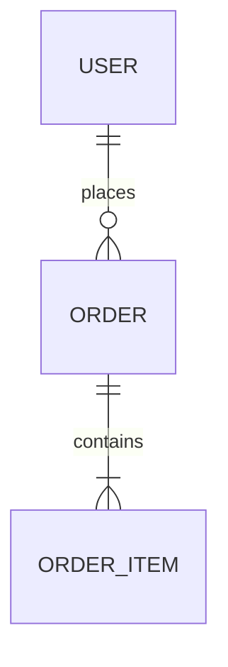
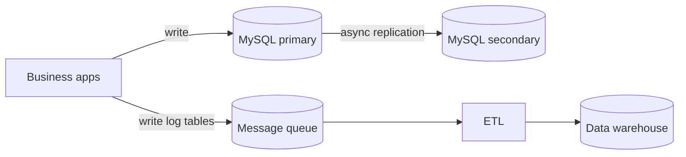

# Data View Template

> Purpose: describe **how data is modeled, where it is stored, how it flows/replicates/shards, and how its lifecycle is managed**. Fills the data dimension missing from the 4+1 view system (drawing on TOGAF data architecture); the direct carrier of high-performance/high-availability storage design. Written mainly for development and DBAs.
>
> Inputs: domain concepts from requirements, Phase 4 storage selection (the conclusions of the high-performance/high-availability references), data-volume estimation (Phase 1).

## Fill-in skeleton

```markdown
## Data view

### 1. Core data entities

<ER outline diagram, see the diagram conventions below; core entities and relations only — fields stay in detailed design>

| Entity | Description | Estimated scale (rows/growth) | Owning service |
|---|---|---|---|
| <order> | <one sentence> | <hundreds of millions, N per day> | <order-service> |

### 2. Storage selection

| Data category | Characteristics | Storage engine | Selection rationale |
|---|---|---|---|
| <transaction data> | <strong consistency, transactional, medium scale> | <MySQL> | <relational + transactions required> |
| <sessions/hotspots> | <read-heavy, loss-tolerant> | <Redis> | <cache acceleration> |
| <full-text search> | <inverted-index queries> | <ES> | <search requirement> |

### 3. Database and table sharding strategy

| Table | Sharded? | Shard key | Routing strategy | Rationale |
|---|---|---|---|---|
| <order> | <horizontal 8 databases × 8 tables> | <user_id> | <hash modulo> | <queries are mostly per-user> |

- Resulting knock-on problems and countermeasures: <cross-database join → redundant fields/heterogeneous indexes; distributed transactions → cite the Phase 4 transaction solution; globally unique IDs → solution X; expansion migration → strategy Y>

### 4. Replication and consistency

| Data | Replication mode | Consistency promise | Conflict handling |
|---|---|---|---|
| <core database> | <MySQL semi-sync primary-secondary> | <strong consistency (read primary) / replication lag window s> | <—> |

### 5. Data flow

<Flow diagram from data creation to consumption; annotate cleansing/aggregation steps>

### 6. Data lifecycle

| Data | Retention policy | Archiving/cleanup method |
|---|---|---|
| <log tables> | <30 days> | <scheduled job/partition drop> |
```

## Diagram conventions

ER outline:



Data flow:



- Scale numbers must appear (estimated rows, growth rate) — they are the basis of sharding and capacity decisions.

## Self-check checklist

- [ ] Does every data category's storage selection have a rationale and match the Phase 4 high-performance/high-availability design?
- [ ] Does the shard key support the dominant query patterns (avoiding cross-shard scans on the main path)?
- [ ] Do the knock-on problems after sharding (join/transactions/unique IDs/expansion) all have countermeasures?
- [ ] Is the replication lag window known, and does the read-primary/read-secondary strategy match the business correctness requirements?
- [ ] Are encryption and access control for sensitive data (passwords/PII) specified (security design)?
- [ ] Does data growth have lifecycle management (no unbounded bloat)?
