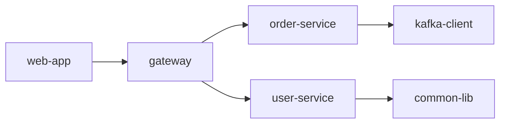

# Development View Template

> Purpose: describe **which developable and deployable units (apps/services/libraries) compose the system, how the code is organized, and the inter-unit dependency and collaboration conventions**. Corresponds to the development view of the 4+1 views; in the common architecture-diagram system it corresponds to the "application architecture diagram". Written mainly for development and testing; the basis of dev-test-ops collaboration.
>
> Inputs: the logical view's role decomposition, Phase 4 technology selections, team size and division of labor.

## Fill-in skeleton

```markdown
## Development view

### 1. App/service list

| App/service | Responsibility | Tech stack | Code repository | Owning team | Split rationale |
|---|---|---|---|---|---|
| <app-gateway> | <unified access> | <Java/Spring> | <repo> | <team> | <business logic/performance/reliability/infrastructure — state which> |

<For complex systems, one section per subdomain with one table each; avoid one table holding hundreds of apps>

### 2. Unit-internal structure (code layering)

Every app adopts the same layering internally:

| Layer | Responsibility | Constraint |
|---|---|---|
| Interface layer | <external REST/RPC definitions> | no business logic |
| Logic layer | <core business rules> | depends on abstractions only; no direct storage dependency |
| Data layer | <DAO/external access wrapping> | replaceable implementations |

<If an app's structure is special, explain it separately>

### 3. Dependencies

<App dependency diagram, see the diagram conventions below; make the "allowed dependency directions" explicit; circular dependencies are forbidden>

| Upstream | Downstream | Dependency mode | Contract |
|---|---|---|---|
| <A> | <B> | <RPC sync / MQ async / SDK reference> | <interface definition location / version policy> |

### 4. Shared components and conventions

| Component | Form | Used by | Version policy |
|---|---|---|---|
| <logging SDK> | <library> | <all apps> | <semantic versioning> |

### 5. Build and environments

- <build method, branching strategy, configuration source (config center/environment variables)>
```

## Diagram conventions



- A node = a program unit that can be developed, tested, and deployed independently — not a logical module (that is the logical view's business).
- Split complex systems into per-subdomain diagrams, one domain per diagram.
- Dependencies flow left-to-right / top-to-bottom; a back edge must be explained (usually event subscription).

## Self-check checklist

- [ ] Is each app's split rationale stated (business logic/extensibility/reliability/performance/infrastructure)? Does the granularity match team size (small teams do not over-split)?
- [ ] Any circular dependencies? Do cross-team dependencies have contracts (interface definitions, version policies)?
- [ ] When microservicing: are service registry and discovery, config center, gateway, and automated deployment/testing/monitoring all in the list and built before the services?
- [ ] Do SDK-type components have an explicit upgrade and compatibility policy?
- [ ] Is the mapping between app names in the table and environments (dev/test/prod) explained?
