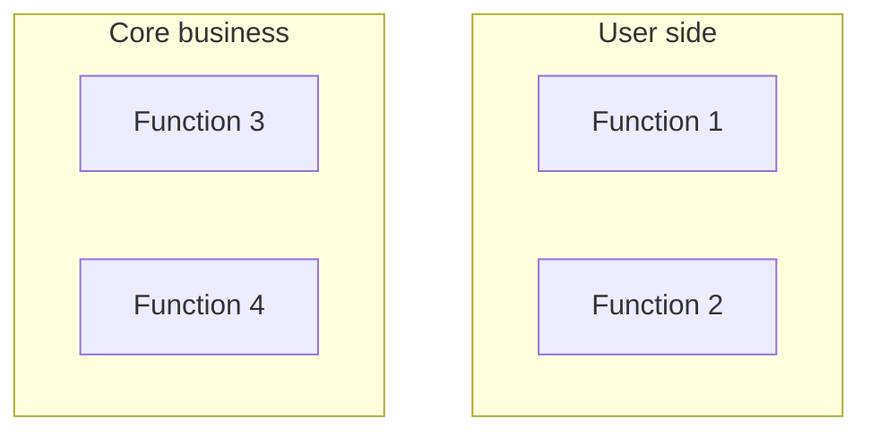
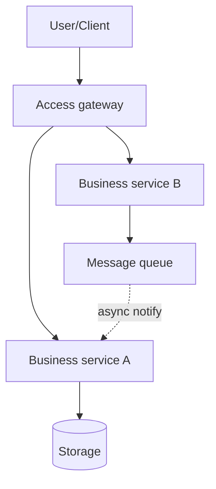

# Logical View Template

> Purpose: describe **what functions the system provides, which logical modules compose it, and how the modules relate**. Corresponds to the logical view + scenario view of the 4+1 views; in the common architecture-diagram system it splits into two diagrams: the "business architecture diagram" (product-facing) and the "system architecture diagram" (technology-facing). Written for everyone, especially cross-team communication and reporting upward.
>
> Inputs: the spec's requirement list, the components and technologies selected in Phase 4.

## Fill-in skeleton

```markdown
## Logical view

### 1. Functional view (business architecture)

<One sentence: whom the system serves and which business capabilities it provides>

| Business group | Business function | Description | Status/notes |
|---|---|---|---|
| <group 1> | <function> | <one-sentence responsibility> | |

(When the business is complex, draw a business architecture diagram: groups as background colors/dashed boxes, ≤3 colors)

### 2. System architecture (Role + Relation)

<One sentence: which logical roles the backend consists of and how they collaborate>

| Role | Responsibility | Technology selection | Key rationale |
|---|---|---|---|
| <gateway> | <unified entry/auth/rate limiting> | <Nginx> | <one sentence> |

<System architecture diagram: see the diagram conventions below>

### 3. Module relations

- <A → B: call relation; state sync/async and protocol>
- <A → C: dependency relation; state the direction>

### 4. Key design points (Rule digest)

- <Design point 1: a one-sentence rule + the problem it solves>
```

## Diagram conventions

Business architecture diagram (functional view):



System architecture diagram (logical roles):



- One diagram expresses one level (Rank) only; start another diagram when drilling down.
- Every line must be explainable: solid = synchronous call, dashed = async/notification; different semantics use different line styles, explained in the legend.
- Color distinguishes role categories or highlights critical paths only, ≤3 colors.
- For complex systems, first draw one "roles + core functions" diagram, then one "role-to-role relations" diagram; do not cram both into one.

## Self-check checklist

- [ ] Does the function list cover all spec requirement scenarios (no more, no less)?
- [ ] Can every role's responsibility be stated in one sentence — no "do-everything modules"?
- [ ] Does every line carry explicit semantics (call direction, sync/async)?
- [ ] Do the key design points correspond to the primary complexities identified in Phase 1?
- [ ] Information density on the diagram: are non-core roles hidden into lower-level views?
