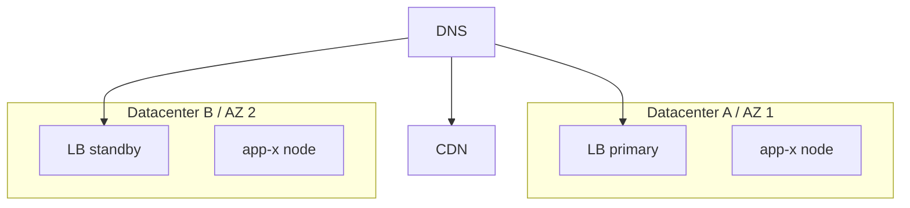

# Physical View Template

> Purpose: describe **what physical infrastructure the system deploys on** — datacenters and availability zones, network topology (domains/DNS/CDN/load balancing), server specs and counts, environment planning, capacity. Corresponds to the physical view of the 4+1 views; in the common architecture-diagram system it corresponds to the "deployment architecture diagram". Written mainly for ops/SRE.
>
> Inputs: the unit list from the logical/development views, Phase 1 capacity estimation, Phase 4 high-availability design (primary-standby/cluster distribution), the spec's cost constraints.

## Fill-in skeleton

```markdown
## Physical view

### 1. Datacenters and network topology

<Deployment topology diagram, see the diagram conventions below; annotate datacenter/availability-zone distribution>

| Link segment | Technology | Description |
|---|---|---|
| Domain resolution | <DNS (round robin/smart resolution)> | |
| Static acceleration | <CDN: yes/no, reason> | |
| Access load balancing | <DNS → Nginx+Keepalived / LVS / hardware LB> | |

### 2. Server planning

| Node role | Count | Spec (cores/memory/disk) | Deployed content | High-availability mode |
|---|---|---|---|---|
| <business servers> | <N> | <8C16G 200G SSD> | <app-x> | <cross-AZ distribution / primary-standby / cluster> |

Capacity basis: <node count = target QPS ÷ measured/estimated per-machine throughput — show the calculation; mixed-deployment notes (e.g., CPU-intensive with disk-intensive)>

### 3. Storage and middleware deployment

| Component | Deployment shape | Replicas/shards | Resources |
|---|---|---|---|
| <MySQL> | <one primary one standby> | <split by business, N databases> | <spec> |

### 4. Environment planning

| Environment | Purpose | Scale strategy |
|---|---|---|
| dev/test/staging/prod | | <proportionally scaled-down production or independent configuration> |

### 5. Availability and capacity notes

- Target availability <99.9%>; corresponding redundancy design: <no-single-point list>
- Scale-out plan: <vertical/horizontal expansion trigger conditions and operations>
```

## Diagram conventions



- Use icons/partitions to express datacenter and AZ boundaries; deployment diagrams allow moderate beautification, but node counts must match the spec table.
- Cross-datacenter deployment must annotate the data sync link and its delay.

## Self-check checklist

- [ ] Any single points (hardware, network, datacenter)? Does every single point have a redundancy plan or an explicit risk statement?
- [ ] Do node counts have a capacity-calculation basis consistent with the Phase 1 estimation?
- [ ] Is failover for primary-standby/cluster components executable at the deployment level (are heartbeat/arbitration components deployed too)?
- [ ] Do specs match the cost constraints (the spec's constraints)? For mixed deployment, is the no-interference rationale explained?
- [ ] Are physical machines/VMs/containers distinguished, with the choice rationale stated?
