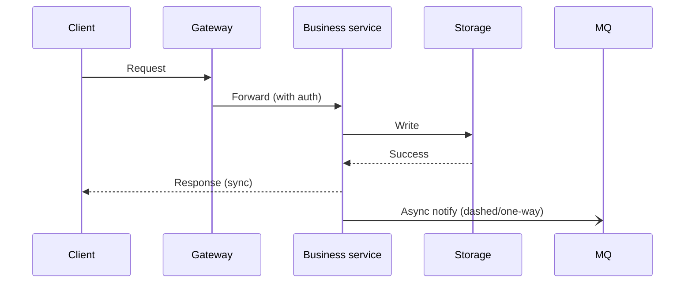

# Runtime View Template

> Purpose: describe **the system's dynamic behavior at runtime** — how the roles collaborate to complete business functions in core scenarios (sequences, sync/async, failure handling), and runtime concerns (concurrency, queues, timeouts, retries). Corresponds to the processing/process view of the 4+1 views; in the common architecture-diagram system it corresponds to the "system sequence diagram". Written mainly for development and testing.
>
> Inputs: the logical view's roles and relations, the spec's key business processes, Phase 4 detailed design (reliability strategies, etc.).
>
> Structural principle: static architecture diagrams (logical/development/physical views) usually number 1–2; for dynamic sequence diagrams — **one per core scenario** — being numerous is normal.

## Fill-in skeleton

```markdown
## Runtime view

### 1. Core scenario list

| Scenario | Trigger | Frequency/scale | Importance | Design points |
|---|---|---|---|---|
| <scenario 1: place order> | <user> | <N QPS at peak> | P0 | <which reliability mechanisms are involved> |

(Sorted by importance; each P0 scenario must have a corresponding sequence diagram and failure analysis)

### 2. Scenario sequence: <scenario 1 name>

<Sequence diagram, see the diagram conventions below>

Key step notes:

| Step | Description | Failure handling |
|---|---|---|
| 1→2 | <what is called, sync/async> | <timeout X seconds / N retries / degradation strategy> |

### 3. Scenario sequence: <scenario 2 name>
(same structure as above; one section per P0/P1 scenario)

### 4. Runtime design decision digest

| Concern | Decision | Basis |
|---|---|---|
| Timeouts | <timeout value per segment> | <load test/heuristic values> |
| Retries | <retry count/backoff policy/idempotency guarantee> | <cite the idempotency design> |
| Async processing | <which steps go through MQ and why> | <decoupling/peak shaving> |
| Concurrency model | <thread pool size/connection count> | <estimation> |
```

## Diagram conventions



- Participants are ordered by call chain, one-to-one with the logical view's roles.
- Synchronous calls use solid arrows; async/notification uses one-way async arrows; responses distinguish success/failure.
- Draw the **failure branches** or explain them in a table — a sequence diagram showing only the happy path has no review value.

## Self-check checklist

- [ ] Does the scenario list cover the spec's key business processes + major exception scenarios?
- [ ] Does each scenario's scale (QPS) match the Phase 1 estimation?
- [ ] Is failure handling per step (timeout/retry/degradation/idempotency) explicit and consistent with the Phase 4 reliability design?
- [ ] How is cross-service state consistency guaranteed (synchronous return / eventual consistency + compensation)?
- [ ] Are concurrency/mutual-exclusion relations between scenarios annotated?
